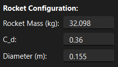
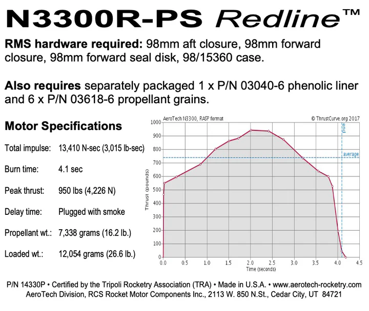
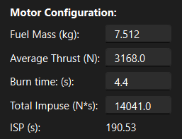
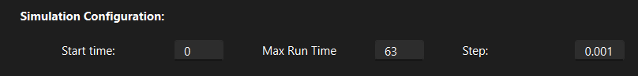
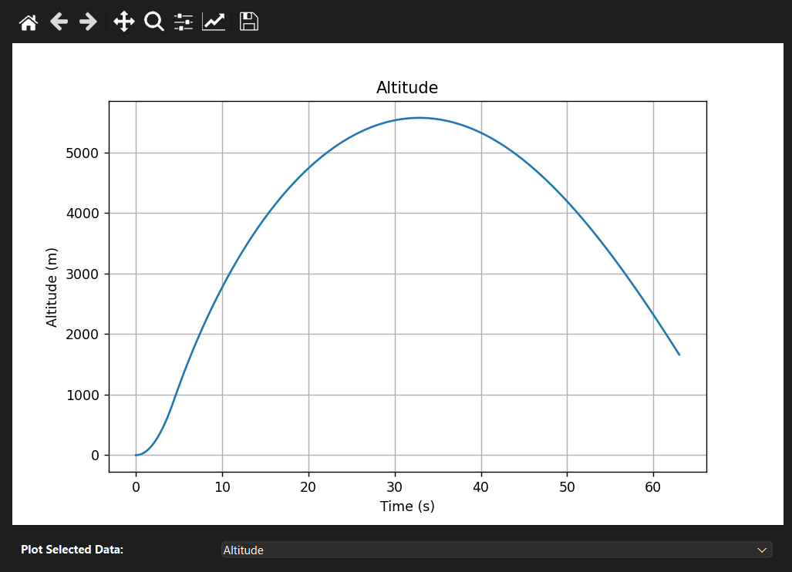

# RocketModel

Rocket model is an easy and approachable way to get first round rocket flight simulations without having to build a OpenRocket model or diving into RocketPy simulations. It features a GUI for easy edditing of simulation parameters and a variety of plots for the simulation. Before using Rocket Model one should note the major assumptions of the model:
  - Gravity is considered constant
  - The rocket's angle of attack is zero for the flight
  - The rocket is stable and rigid
  - The motor burns consistently and evenly at average thrust


## Installation 

### Application Download
RocketModel application can be installed from [Releases.](https://github.com/andrerhenry/RocketModel/releases)

### Cloning Repository
To install for development or to run the source code, clone the the repository with:
```bash 
git clone https://github.com/andrerhenry/RocketModel
cd RocketModel
```

### Setting Up Environment
UV is implemented to manage the project environment. After cloning the repository, run:
```bash
uv sync
```

This will install the dependencies and set up the virtual environment.

To activate the environment, use:
```bash
source .venv/bin/activate
```


## Running Rocket Model
After installing dependencies, the project can now be run with: 
```bash
uv run src/rocket_model/main.py
```
or 
```bash
python src/rocket_model/main.py
```


## User Guide
### Running the Rocket Model Application
To start an simulation, first edit the Rocket Configuration. Input the basic attributes of your rocket.



Next, fill out the Motor Configuration using the data from your motor data sheet:





Adjust the simulation time and simulation resolution as needed:



The figure section shows plots of simulation. The current plot can be changed with the drop down menu at the bottom of the window. 




### Running Rocket Model Script
The simulation module can be run as a standalone file if you prefer to run the simulation in a script form. Edit the `if __name__== "__main__":` section and then run the simulation module with either of the following commands:
```bash
uv run src/rocket_model/simulation.simulation.py
```
or 
```bash
python src/rocket_model/simulation.simulation.py
```

## Acknowledgements 

I would like to give a special thanks to Dr. Carlos Montalvo of University of South Alabama and his video series that showed me that simulations of rockets in Python are more accessible than I initially imagined.

I would also like to extend my thanks to the Reddit community, r/learnpython,  for the countless lessons and invaluable interactions that greatly aided my journey in learning Python.

## License
Rocket Module is licensed under the MIT License.
